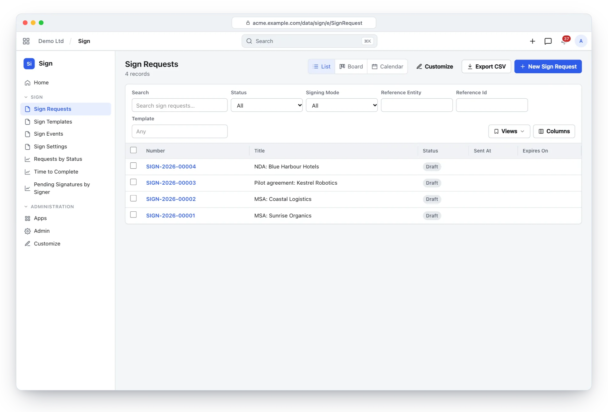
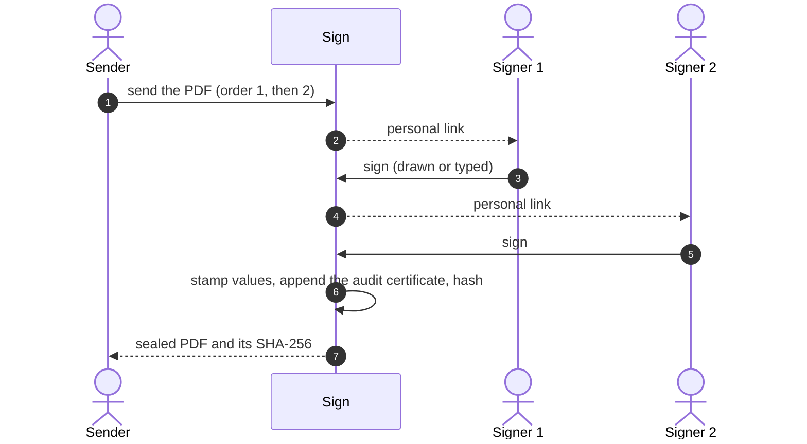
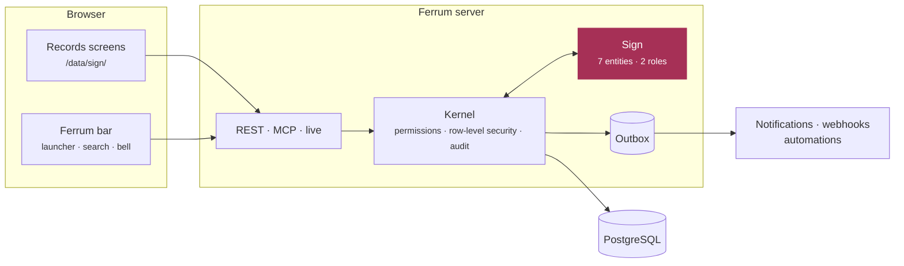
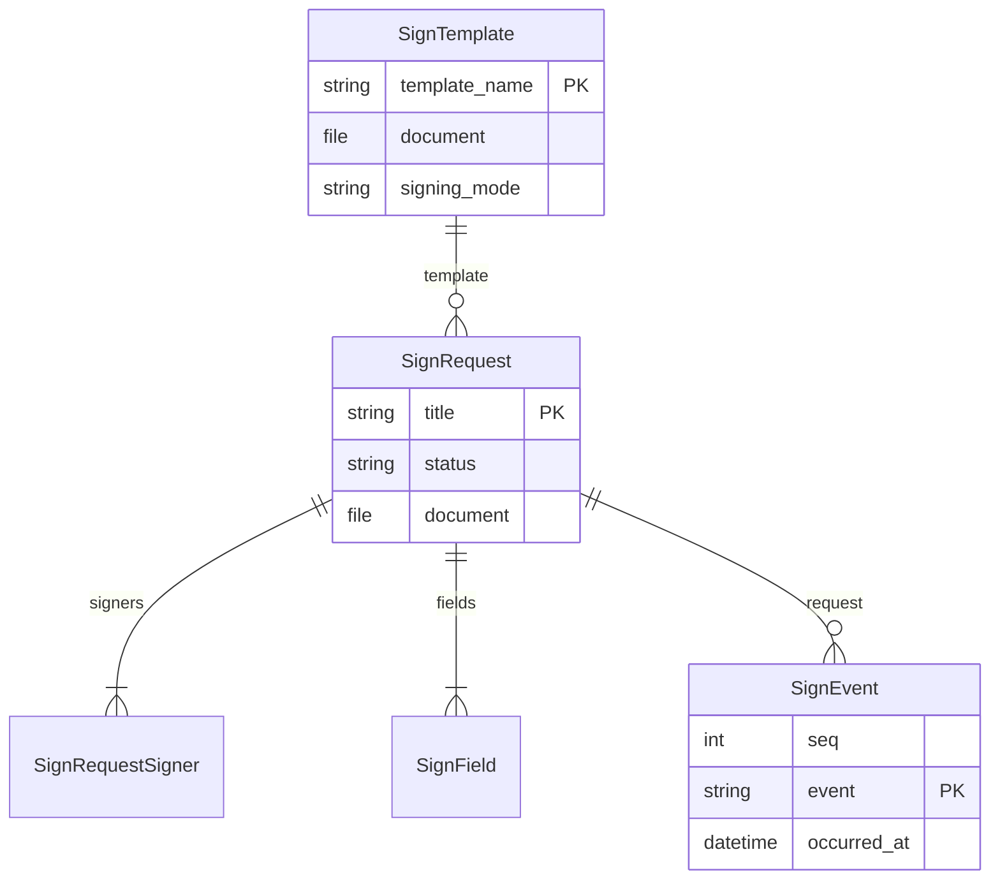

<div align="center">

<picture>
  <source media="(prefers-color-scheme: dark)" srcset="docs/assets/banner-dark.svg">
  
</picture>

[](https://github.com/CBFerrum/ferrum-app-sign/actions/workflows/ci.yml)     

**A native app for [Ferrum](https://github.com/CBFerrum/Ferrum), the open-source, AI-first business platform.**

[Overview](#overview) · [Highlights](#highlights) · [Screenshots](#screenshots) · [How it works](#how-it-works) · [Data model](#data-model) · [Install](#install) · [Develop](#develop) · [Changelog](#changelog)

</div>

---

## Overview

Ferrum Sign sends PDFs for signature: an upload or a reusable template, linked to any record.
Signers sign in order or at once through personal, expiring, single-use links; values are stamped
onto the original pages and an audit certificate appended as an incremental update, so the signed
document is a byte-exact prefix of the sealed file; and a hash-chained audit trail records every
step.


| At a glance | |
|---|---|
| 📦 Version | `0.1.0` |
| 🧱 Platform | Ferrum `>=0.3, <0.4` |
| 🔗 Requires | nothing else |
| 🖥️ Interface | Ferrum's records screens (`/data/sign/`) |
| 🗃️ Records | 7 entities in 1 package |
| 👥 Roles | 2: Sign User, Sign Manager |
| 📊 Reports | 3 |
| 🧪 Tests | 15 Rust tests |


> [!IMPORTANT]
> This is an electronic signature with an audit trail, not a PAdES digital signature: integrity rests on the SHA-256 values and the audit trail.


## Highlights

<table>
<tr>
<td width="50%" valign="top">

### 📄 Any PDF
An upload or a template, numbered and linked to a quotation or contract.

</td>
<td width="50%" valign="top">

### 🧭 Routing
Sequential or parallel signers; fields per role placed on any page.

</td>
</tr>
<tr>
<td width="50%" valign="top">

### 🔐 Personal links
HMAC tokens that expire, are single-use and checked in constant time; access codes.

</td>
<td width="50%" valign="top">

### ✒️ Sign or decline
A drawn or typed signature, or a decline with a reason.

</td>
</tr>
<tr>
<td width="50%" valign="top">

### 🧷 Sealed PDFs
Values stamped and an audit certificate appended; SHA-256 kept.

</td>
<td width="50%" valign="top">

### ⛓️ Audit trail
Append-only and hash-chained; a public endpoint verifies a sealed PDF.

</td>
</tr>
</table>

## Screenshots

<picture>
  <source media="(prefers-color-scheme: dark)" srcset="docs/assets/sign-dark.webp">
  
</picture>

<p align="center"><sub>Sign requests and where each one stands.</sub></p>

> [!TIP]
> The screenshots follow your GitHub theme: switch between light and dark to see both.

## How it works

### Signing and sealing



### Inside Ferrum



Everything Sign adds is ordinary Ferrum metadata and Rust: its records get lists, forms,
search, permissions, an audit trail, exports and the REST and MCP APIs for free, so AI agents work
with them under the same rules as people.

## Data model

The main records and how they connect (7 entities in all; `packages/` has every field).



### Roles

| Role | What it is for | Entities |
|---|---|---|
| **Sign User** | Sends their own documents for signature (uploads or templates), follows them and reads their audit trails. | 4 |
| **Sign Manager** | Every sign request and audit trail, templates and Sign Settings (including rotating the signing key). | 4 |

<details>
<summary><b>Reports (3)</b></summary>

- Sign Requests By Status
- Sign Completion Time
- Sign Pending Signatures

</details>

## Install

Workspace administrators install it from **Apps** (`/store/`) in Ferrum; it ships in the
official Ferrum server image. Self-hosters building their own image enable the
`sign` feature of the server. Everything it adds is also available to AI agents over
Ferrum's MCP server, within each person's permissions.

## Develop

Clone it next to the platform:

```text
work/
├── ferrum/            https://github.com/CBFerrum/Ferrum
└── ferrum-app-sign/
```

Point the platform dependencies at your checkout (this file is git-ignored):

```toml
# .cargo/config.toml
[patch."https://github.com/CBFerrum/Ferrum"]
ferrum-calc = { path = "../ferrum/crates/calc" }
ferrum-domain = { path = "../ferrum/crates/domain" }
ferrum-kernel = { path = "../ferrum/crates/kernel" }
ferrum-meta = { path = "../ferrum/crates/meta" }
```

The tests need PostgreSQL with an ordinary (non-superuser) role, so row-level security
applies:

```bash
createuser ferrum --pwprompt && createdb -O ferrum ferrum_sign_test
cargo test
```

`FERRUM_SIGN_TEST_DATABASE_URL` overrides the database URL.


### Project layout

```text
app.yaml      the manifest: id, version, requirements, what it adds to Ferrum
packages/     metadata: entities, roles, reports, workflows, print formats
src/          the app's logic in Rust: hooks, actions, endpoints, upkeep jobs
tests/        integration tests against a real PostgreSQL
CHANGELOG.md  what changed in each version
```


It builds on [ferrum-app-comms](https://github.com/CBFerrum/ferrum-app-comms).

## Changelog

| Version | Highlights |
|---|---|
| **0.1.0** | First release. Sign requests send a PDF — uploaded or from a reusable template, optionally linked to any record — to signers in a sequential … |

Every version is in [CHANGELOG.md](CHANGELOG.md).

## License

[AGPL-3.0-only](LICENSE), like the platform. Part of [Ferrum](https://github.com/CBFerrum/Ferrum) ·
[Report an issue](https://github.com/CBFerrum/ferrum-app-sign/issues)
